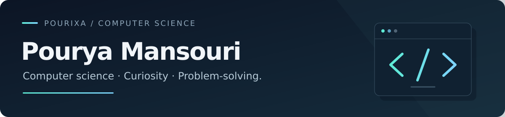

  

  <strong>Computer science at Université de Haute-Alsace · Mulhouse, France</strong> 
  Building web applications, exploring ideas, and learning through projects.

  <a href="#selected-projects">Projects</a> ·
  <a href="#technologies">Technologies</a> ·
  <a href="#what-im-working-toward">Current focus</a>

---

## About me

I'm **Pourya**, a computer science student at **Université de Haute-Alsace (UHA)**. I build full-stack applications, from interactive React interfaces to APIs and relational databases.

My projects explore social feeds, real-time messaging, and browser games. I enjoy understanding how the pieces fit together: how data is modelled, how an interaction reaches the server, and how the interface stays in sync.

**I'm open to software development internships and student or part-time technical opportunities.**

## Selected projects

| Project | What I built | Technologies |
| :--- | :--- | :--- |
| **[Xenia](https://github.com/Pourixa/Xenia)** | A social application with posts, image uploads, following feeds, and activity notifications. | React · Express · PostgreSQL · Prisma |
| **[Whisp](https://github.com/Pourixa/Whisp)** | A messaging application with direct and group conversations, persisted history, and real-time updates. | TypeScript · React · Socket.IO · PostgreSQL |
| **[Where's Waldo?](https://github.com/Pourixa/Where-s-Waldo)** | A visual search game with image zoom, server-side guess validation, and per-scene leaderboards. | React · Express · PostgreSQL · Prisma |
| **[Guitar Chord Memory Game](https://github.com/Pourixa/MemoryCard)** | A guitar-themed memory game with shuffled chord diagrams and score tracking. | React · JavaScript · CSS |

Each repository explains the implementation, local setup, and current limitations.

**More work:** [CVBuilder](https://github.com/Pourixa/CVBuilder) — live CV editing and print layouts · [Battleship](https://github.com/Pourixa/battleship) — board modelling and browser game logic.

## Technologies

| Area | Tools and languages |
| :--- | :--- |
| Frontend | TypeScript, JavaScript, React, HTML, CSS, Tailwind CSS |
| Backend & real-time | Node.js, Express, Socket.IO |
| Data | PostgreSQL, Prisma |
| Other languages | Python, C++, Java |
| Development tools | Git, GitHub, Vite, Webpack |

## What I'm working toward

- **A clearer portfolio:** presenting my projects and the decisions behind them.
- **More reliable applications:** improving validation, error handling, and automated testing.
- **Professional experience:** bringing my project experience into a development team and learning from real-world constraints.

---

Outside programming, I play **electric guitar**. The chord memory game is one place where those two interests meet.
